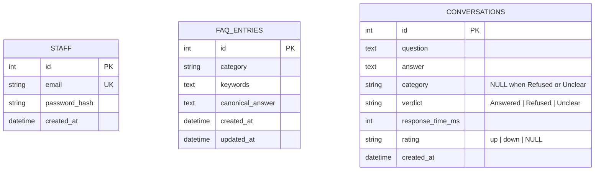
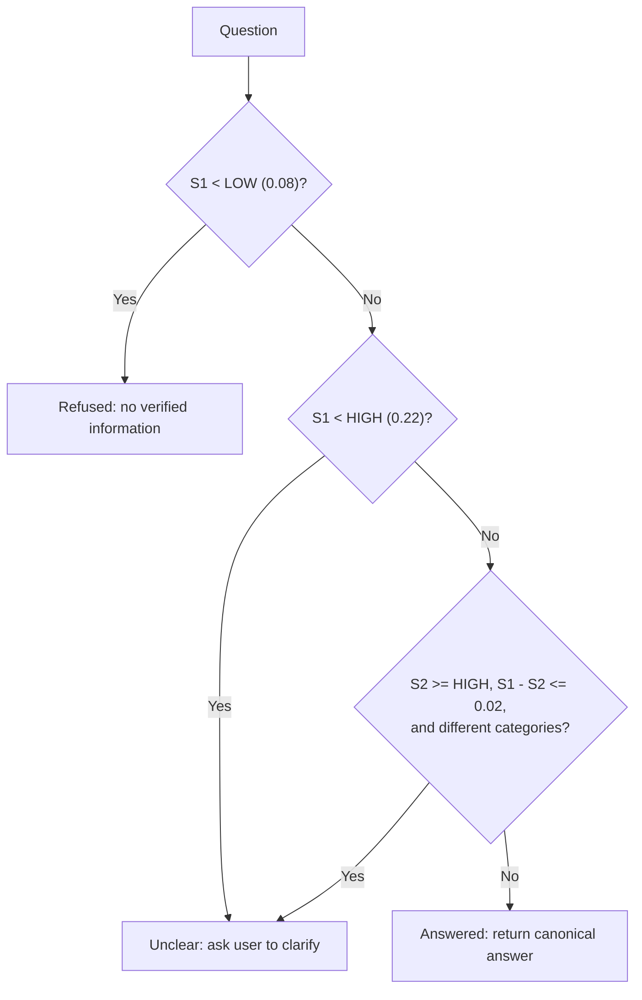

# Arc Lite – FAQ Assistant for ArchintX

Arc Lite answers questions about ArchintX **courses, certificates, jobs and accounts** from a staff-managed FAQ knowledge base. Its one rule: **refuse, don't guess.** If no FAQ entry matches confidently, it says so instead of inventing an answer.

| | |
|---|---|
| **Live frontend** | `https://archintx-arclite.vercel.app` |
| **Live backend API** | `https://arclite-backend.onrender.com` (interactive docs at `/docs`, health check at `/health`) |
| **Staff test login** | Provided in the submission form (not stored in this repo) |

> **Note:** the backend runs on a free tier and sleeps when idle. The first request after a quiet period can take 30–60 seconds. Please retry once if it seems slow.

---

## 1. Features

- **Public chat page** (no login): question box, answer, matched category, verdict badge (Answered / Unclear / Refused), response time, thumbs up / down.
- **Staff login**: email + password, JWT token, real error on wrong credentials.
- **FAQ Manager** (staff): add, edit, delete, search and filter entries (category, trigger keywords, canonical answer). Changes affect matching immediately, no restart needed.
- **Analytics dashboard** (staff): verdict counts by category, average response time by category, and every conversation marked `Answered` but rated `down`. All numbers are computed live from the `conversations` table.
- Responsive at desktop and mobile widths. All on-screen data comes from the API.

## 2. Tech stack and why

| Layer | Choice |
|---|---|
| Frontend | React + Vite + TypeScript, Tailwind CSS, Axios, Recharts (hosted on Vercel) |
| Backend | Python, FastAPI, SQLAlchemy 2 (hosted on Render) |
| Matching | scikit-learn `TfidfVectorizer` + cosine similarity (no LLM) |
| Auth | Argon2 password hashing, JWT (PyJWT) |
| Database | **PostgreSQL on Neon** in production, SQLite for local development |

**Why PostgreSQL (Neon):** the analytics need real aggregation (`COUNT`, `AVG`, `GROUP BY`) over a growing `conversations` table, and ratings are written concurrently by public users. PostgreSQL handles concurrent writes safely, its free tier is hosted (not localhost), and SQLAlchemy lets the same code run on SQLite locally with zero setup. A document store would add nothing here because the data is small, relational and fixed-shape.

## 3. Database schema

Production uses PostgreSQL so the web service can safely share durable data across instances and use a managed database for backups and operations. SQLite is intended for local development and tests.



`conversations` is not linked by foreign key to `faq_entries` on purpose: a conversation is an audit record, so it must stay intact if staff later edit or delete the FAQ entry that answered it. The answer text is stored on the row.

```sql
CREATE TABLE faq_entries (
  id SERIAL PRIMARY KEY,
  category VARCHAR(50) NOT NULL,          -- Courses | Certificates | Jobs | Account
  keywords TEXT NOT NULL,                 -- trigger keywords / phrases
  canonical_answer TEXT NOT NULL,
  created_at TIMESTAMPTZ, updated_at TIMESTAMPTZ
);
CREATE TABLE conversations (
  id SERIAL PRIMARY KEY,
  question TEXT NOT NULL,
  answer TEXT NOT NULL,
  category VARCHAR(50),                   -- NULL for Refused / Unclear
  verdict VARCHAR(20) NOT NULL,
  response_time_ms INTEGER NOT NULL,      -- measured per request
  rating VARCHAR(10),                     -- 'up' | 'down' | NULL
  created_at TIMESTAMPTZ
);
CREATE TABLE staff (
  id SERIAL PRIMARY KEY,
  email VARCHAR(255) UNIQUE NOT NULL,
  password_hash VARCHAR(255) NOT NULL,    -- Argon2 hash, never plain text
  created_at TIMESTAMPTZ
);
```

The API restricts FAQ categories to `Courses`, `Certificates`, `Jobs`, and `Account`.

**Seed data** (runs on startup only when tables are empty): 14 FAQ entries (Courses 5, Certificates 3, Jobs 3, Account 3) and one staff account created from the `ADMIN_EMAIL` / `ADMIN_PASSWORD` environment variables. There is no public signup.

## 4. How the matching works

1. **Clean** the question (lowercase, collapse whitespace). Empty or under 3 characters → `Refused`.
2. **Load** all FAQ entries from the database (so staff edits apply instantly).
3. **Vectorise.** For each FAQ, the document is its trigger keywords plus its category name (repeated 3 times). The canonical answer text is deliberately *not* used, so answer wording cannot create false matches. TF-IDF uses unigrams and bigrams and removes English stop words plus domain noise words ("hello", "please", "archintx", …).
4. **Score** the question against every FAQ with cosine similarity. Let `S1` be the best score and `S2` the runner-up.
5. **Decide:**



| Setting | Default | Meaning |
|---|---|---|
| `LOW_CONFIDENCE_THRESHOLD` | 0.08 | below this → `Refused` (unrelated) |
| `HIGH_CONFIDENCE_THRESHOLD` | 0.22 | below this → `Unclear`; at or above → eligible to answer |
| `AMBIGUITY_MARGIN` | 0.02 | two close scores from *different* categories → `Unclear` |

Two close scores from the *same* category are not treated as ambiguous: the higher-scoring entry wins. Only canonical answers written by staff are ever returned, so Arc Lite cannot produce text that is not in the knowledge base.

**Response time** is measured with `time.perf_counter()` around the database fetch plus matching for each request, then stored on the conversation row (minimum recorded value is 1 ms).

## 5. API

| Method and path | Access | Success | Errors |
|---|---|---|---|
| `POST /chat` `{question}` | public | 200 `{conversation_id, answer, category, verdict, response_time_ms}` | 400 blank, 422 missing/invalid body or question over 500 characters |
| `POST /chat/{id}/rate` `{rating: "up"\|"down"}` | public | 200 | 404 unknown id, 422 bad rating |
| `POST /auth/login` `{email, password}` | public | 200 `{access_token, token_type, email}` | 401 wrong credentials |
| `GET /auth/me` | staff | 200 | 401 |
| `GET /admin/faq?search=&category=` | staff | 200 list | 401 |
| `POST /admin/faq` | staff | 201 | 400 empty field or unsupported category, 401 |
| `PUT /admin/faq/{id}` | staff | 200 | 400 invalid field or unsupported category, 401, 404 |
| `DELETE /admin/faq/{id}` | staff | 200 | 401, 404 |
| `GET /admin/stats` | staff | 200 summary, verdict-by-category, avg response time by category, answered-but-rated-down list, recent conversations | 401 |

Staff routes need the header `Authorization: Bearer <token>`.

## 6. Environment variables

**Backend** (see `.env.example`):

| Variable | Purpose |
|---|---|
| `DATABASE_URL` | PostgreSQL connection string (defaults to local SQLite) |
| `JWT_SECRET_KEY` | Random secret of at least 32 characters; required at startup |
| `ADMIN_EMAIL` | Staff email for the seeded account |
| `ADMIN_PASSWORD` | Staff password of at least 12 characters; required at startup |
| `FRONTEND_URL` | exact deployed frontend origin for CORS, no trailing slash |
| `HIGH_CONFIDENCE_THRESHOLD`, `LOW_CONFIDENCE_THRESHOLD`, `AMBIGUITY_MARGIN` | matching thresholds |

**Frontend:** `VITE_API_BASE_URL` = `https://arclite-backend.onrender.com`. It is read at **build time**, so set it in Vercel before deploying and redeploy after changing it.

## 7. Run locally

Use Python 3.11 as specified in `.python-version`. Before starting the backend, copy `.env.example` to `.env` and set `JWT_SECRET_KEY` to a random value of at least 32 characters and `ADMIN_PASSWORD` to a strong password of at least 12 characters. The backend will not start if either value is missing or too short. Never commit `.env`.

```bash
# Backend (from the repo root)
python -m venv .venv
source .venv/bin/activate            # Windows: .\.venv\Scripts\activate
pip install -r backend/requirements.txt
cp .env.example .env                 # then fill in values
python -m backend.app.seed           # creates tables, FAQs, staff account
uvicorn backend.app.main:app --reload --port 8000

# Frontend
cd frontend
cp .env.example .env                 # VITE_API_BASE_URL=http://localhost:8000
npm install
npm run dev                          # http://localhost:5173
```

## 8. Tests

```bash
python -m pytest -v backend/tests/test_all.py
```

14 tests cover matching, refusal and ambiguity behavior, question-length validation, conversation logging, feedback, staff authentication, category validation, authorization, FAQ updates, and analytics.

## 9. Deployment

- **Frontend (Vercel):** root directory `frontend`, set `VITE_API_BASE_URL=https://arclite-backend.onrender.com`, and redeploy after changing environment variables. `vercel.json` rewrites all routes to `index.html`.
- **Backend (Render):** use Python 3.11 (from `.python-version`), build with `pip install -r backend/requirements.txt`, and start with `uvicorn backend.app.main:app --host 0.0.0.0 --port $PORT`. Set the environment variables above in Render, including the exact CORS origin `FRONTEND_URL=https://archintx-arclite.vercel.app`.
- **Database (Neon):** set `DATABASE_URL` in the Render service to the intended Neon PostgreSQL connection string. Tables and seed data are created automatically on first start.

### Live URLs
- Frontend: [https://archintx-arclite.vercel.app](https://archintx-arclite.vercel.app)
- Backend API: [https://arclite-backend.onrender.com](https://arclite-backend.onrender.com) (`/health` and `/docs`)

## 10. Security notes

- Passwords are hashed with Argon2 and are never stored, returned or logged in plain text.
- Staff routes verify a signed JWT on every request; there is no public signup.
- All database access goes through SQLAlchemy (parameterised queries).
- Secrets live in environment variables; `.env` files and local `.db` files are git-ignored.

## 11. Known limitations

- Matching is keyword-based, so a question that shares a topic word with an FAQ (for example "course") but asks about something the FAQ does not cover can still score above the threshold. Keeping trigger keywords specific, and reviewing the dashboard's "Answered but rated down" list, is how staff catch these.
- The free hosting tier has cold starts.
